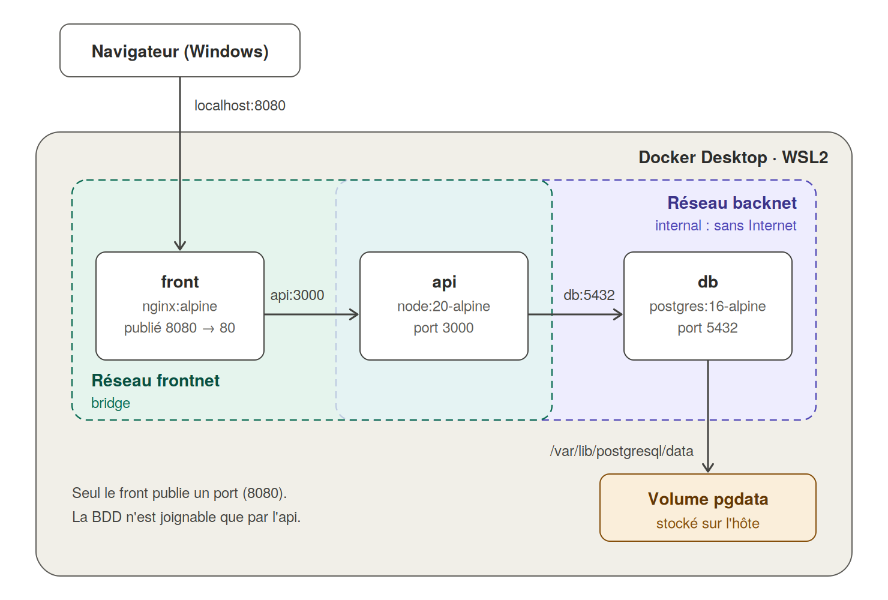

# TP Docker Compose : Mur de post-its

## 1. Objectif

Déployer avec Docker Compose une application web à plusieurs conteneurs, avec :

- un **front** (page web) qui permet d'écrire des messages,
- une **API** qui fait le lien entre le front et la base,
- une **base PostgreSQL** qui stocke les messages,
- des **réseaux séparés** pour isoler la base du front,
- un **volume nommé** pour que les données survivent à la suppression des conteneurs,
- un fichier **`.env`** pour ne pas écrire les mots de passe dans le code.

L'application est un mur de post-its : chaque visiteur colle un message coloré, il est enregistré en base et visible par tous.

## 2. Architecture



Le trajet d'une requête :

```
navigateur → front (nginx) → api (Node.js) → db (PostgreSQL) → volume pgdata
```

Une page web ne peut pas parler directement à PostgreSQL (le navigateur ne sait pas utiliser ce protocole, et exposer la base à Internet serait dangereux). L'API joue donc le rôle d'intermédiaire : elle reçoit des requêtes HTTP du front et les transforme en requêtes SQL.

## 3. Contenu du projet

```
postit-wall/
├── docker-compose.yml     # description de toute la stack
├── .env                   # variables secrètes (NON versionné)
├── .env.example           # modèle de .env à partager
├── .gitignore             # exclut .env de Git
├── docs/
│   ├── DOCUMENTATION.md   # ce document
│   ├── architecture.png   # schéma (version image)
│   └── architecture.svg   # schéma (version vectorielle)
├── front/
│   ├── Dockerfile
│   ├── nginx.conf         # redirige /api/ vers le service api
│   └── index.html         # la page du mur
└── api/
    ├── Dockerfile
    ├── package.json
    └── server.js          # routes /notes, /info, /health
```

## 4. Les services

| Service | Image | Port interne | Port publié | Réseaux | Rôle |
|---|---|---|---|---|---|
| `front` | `nginx:alpine` (build local) | 80 | **8080** | frontnet | Sert la page et redirige `/api/` vers l'API |
| `api` | `node:20-alpine` (build local) | 3000 | aucun | frontnet, backnet | Lit et écrit dans la base |
| `db` | `postgres:16-alpine` | 5432 | aucun | backnet | Stocke les post-its |

Points importants :

- **`depends_on` avec `condition: service_healthy`** : Compose attend que la base soit prête (`pg_isready`) avant de démarrer l'API, et que l'API réponde (`/health`) avant de démarrer le front. Sans cela, l'API planterait au démarrage car la base n'accepte pas encore de connexions.
- **`restart: unless-stopped`** : les conteneurs redémarrent seuls après un reboot ou un plantage (c'est la partie « résilience »).
- **Les noms de service servent de noms DNS** : l'API contacte la base avec `DB_HOST=db`, le front contacte l'API avec `http://api:3000`.

## 5. Les réseaux

| Réseau | Membres | Particularité |
|---|---|---|
| `frontnet` | front, api | Réseau bridge classique |
| `backnet` | api, db | `internal: true` : aucun accès à Internet |

**Pourquoi deux réseaux ?** C'est le principe de l'isolation par couches :

- Le `front` est la partie exposée à l'extérieur. Si elle était compromise, elle ne pourrait pas atteindre la base, car elle n'est pas sur `backnet`.
- Seule l'`api` est dans les deux réseaux : c'est le seul pont autorisé.
- `internal: true` empêche la base de sortir sur Internet (pas de téléchargement, pas de fuite de données par ce chemin).

Dans un même réseau, il n'y a pas de pare-feu entre conteneurs : tous les ports sont joignables. L'isolation vient du fait que des conteneurs de réseaux différents ne se voient pas du tout (pas de route, pas de DNS).

Compose préfixe les noms de réseaux par le nom du projet : `postit-wall_frontnet` et `postit-wall_backnet`.

## 6. Persistance des données

Le volume nommé `pgdata` est monté sur `/var/lib/postgresql/data`, le dossier où PostgreSQL range ses fichiers.

- Si on supprime les conteneurs (`docker compose down`), le volume est conservé et les post-its sont toujours là au prochain `up`.
- Seule la commande `docker compose down -v` supprime aussi le volume, donc les données.
- Aucune donnée n'est stockée dans la couche inscriptible du conteneur.

## 7. Variables d'environnement (`.env`)

| Variable | Rôle | Exemple |
|---|---|---|
| `POSTGRES_USER` | Utilisateur de la base | `postit` |
| `POSTGRES_PASSWORD` | Mot de passe | *(secret)* |
| `POSTGRES_DB` | Nom de la base | `postitdb` |
| `FRONT_PORT` | Port publié sur l'hôte | `8080` |

Compose lit automatiquement `.env` et remplace les `${VARIABLE}` du `docker-compose.yml`.

**Bonnes pratiques :**

- `.env` est dans `.gitignore` : il ne doit **jamais** être publié sur Git.
- On fournit `.env.example` (sans le vrai mot de passe) pour que quelqu'un d'autre puisse recréer le sien : `cp .env.example .env`.
- Vérifier ce que Compose a réellement résolu : `docker compose config`.

## 8. Lancement

Depuis le dossier du projet, dans le terminal WSL :

```bash
docker compose up -d --build   # construit les images et démarre tout
docker compose ps              # état des services (healthy attendu)
docker compose logs -f api     # suivre les logs de l'API
```

Puis ouvrir `http://localhost:8080` dans le navigateur.

Arrêt :

```bash
docker compose down            # supprime conteneurs et réseaux, GARDE le volume
docker compose down -v         # supprime aussi le volume (données perdues)
```

## 9. Tests de validation

### 9.1 L'application fonctionne

Ajouter un post-it dans le navigateur. Le pied de page affiche le nombre de post-its, le nom du conteneur API et l'IP interne de la base.

### 9.2 L'API joint bien la base

```bash
curl http://localhost:8080/api/info
```

Réponse attendue (valeurs différentes chez toi) :

```json
{"api_host":"a1b2c3d4e5f6","db_ip":"172.x.x.x","total":1}
```

Cette route fait une requête SQL : si elle répond, la chaîne complète front → api → db fonctionne.

### 9.3 Résolution DNS par nom

```bash
docker compose exec api getent hosts db
```

Doit afficher l'IP de `db` sur `backnet`.

### 9.4 Isolation : le front ne voit pas la base

```bash
docker compose exec front getent hosts db
```

Aucune sortie : le `front` n'est pas sur `backnet`, il ne sait pas résoudre `db`.

### 9.5 Contenu de la base

```bash
docker compose exec db sh -c 'psql -U "$POSTGRES_USER" -d "$POSTGRES_DB" -c "SELECT * FROM notes;"'
```

### 9.6 Persistance (critère de validation)

```bash
docker compose down
docker compose up -d
```

Recharger la page : les post-its sont toujours présents.
Preuve plus forte (reboot) : redémarrer le PC, relancer Docker Desktop, puis `docker compose up -d`.

## 10. Topologie réseau : IP/DNS internes vs ports publiés

Commandes pour relever les informations :

```bash
# Conteneurs et IP de chaque réseau
docker network inspect postit-wall_frontnet -f '{{range .Containers}}{{.Name}} -> {{.IPv4Address}}{{"\n"}}{{end}}'
docker network inspect postit-wall_backnet  -f '{{range .Containers}}{{.Name}} -> {{.IPv4Address}}{{"\n"}}{{end}}'

# Sous-réseau de chaque réseau
docker network inspect postit-wall_backnet -f '{{range .IPAM.Config}}{{.Subnet}}{{end}}'

# Ports publiés
docker compose ps
docker compose port front 80
```

Tableau à compléter avec les valeurs relevées :

| Service | Nom DNS interne | IP sur frontnet | IP sur backnet | Port interne | Port publié |
|---|---|---|---|---|---|
| front | `front` | ... | (aucune) | 80 | 8080 |
| api | `api` | ... | ... | 3000 | aucun |
| db | `db` | (aucune) | ... | 5432 | aucun |

**À retenir :**

- L'**IP et le DNS internes** ne sont utilisables que par les conteneurs d'un même réseau. Les IP changent à chaque recréation, c'est pourquoi on utilise les noms.
- Le **port publié** (`8080:80`) relie un port de l'hôte à un port du conteneur. Il n'est nécessaire que pour l'accès depuis l'extérieur, jamais entre conteneurs.
- Moins il y a de ports publiés, plus la surface d'attaque est petite : ici un seul.

## 11. Différences avec le TP précédent (`docker run`)

| TP précédent | Ce TP |
|---|---|
| `docker network create appnet` à la main | Réseaux déclarés dans `networks:` et créés par Compose |
| `docker run -v pgdata:...` | `volumes:` dans le fichier |
| Options répétées à chaque `docker run` | Tout est décrit une fois dans `docker-compose.yml` |
| Un seul réseau | Deux réseaux (front/back) |
| Variables écrites dans la commande | Variables dans `.env` |
| `docker start` à la main dans l'ordre | `depends_on` + `healthcheck` gèrent l'ordre |

Compose décrit l'état voulu de l'infrastructure dans un fichier, ce qui rend le déploiement reproductible : un seul `docker compose up` recrée tout.

## 12. Dépannage

| Problème | Piste |
|---|---|
| `docker: command not found` dans WSL | Activer l'intégration WSL dans Docker Desktop (Settings → Resources → WSL Integration) |
| `port is already allocated` | Le port 8080 est pris : changer `FRONT_PORT` dans `.env` |
| `variable is not set` | Le `.env` est absent ou mal placé : il doit être à côté du `docker-compose.yml` |
| `api` reste `unhealthy` | `docker compose logs api` : souvent mauvais mot de passe ou base pas prête |
| Mot de passe changé dans `.env` mais la base refuse | PostgreSQL ne lit `POSTGRES_PASSWORD` qu'à la **première** initialisation du volume : `docker compose down -v` puis `up` |
| La page s'affiche mais pas de post-its | `docker compose logs front api` ; tester `curl http://localhost:8080/api/notes` |

## 13. Commandes utiles

```bash
docker compose config          # affiche la config avec les variables résolues
docker compose ps -a           # état de tous les services
docker compose logs -f         # logs de tous les services
docker compose restart api     # redémarrer un service
docker compose exec api sh     # ouvrir un shell dans un conteneur
docker volume ls               # lister les volumes
docker volume inspect postit-wall_pgdata
```

Le volume créé par Compose s'appelle `postit-wall_pgdata` (préfixé par le nom du projet).
